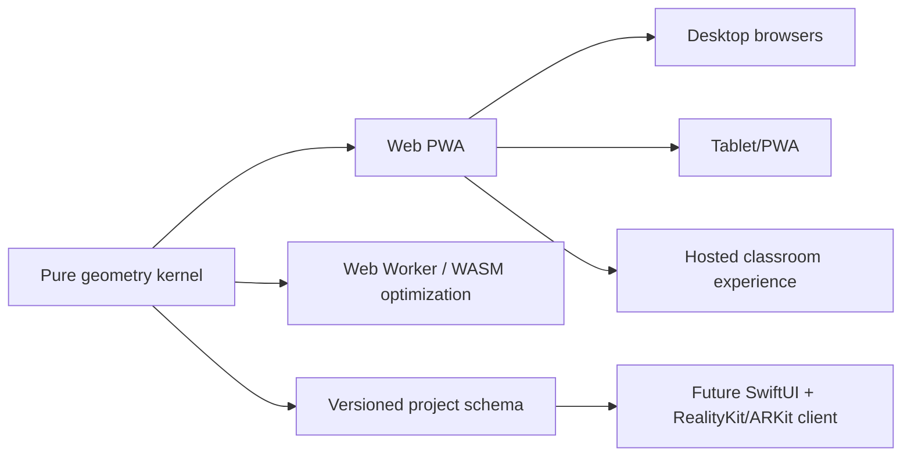

# 02 — Platform Decision

## Decision

Build **web-first as an installable PWA**, with a renderer-independent geometry kernel and a clean data contract that can later support a native SwiftUI/RealityKit client.

The initial production renderer is Three.js/WebGL. WebGPU should be added as a progressive enhancement after feature parity and device testing, not used as the only path. A Canvas 2D renderer remains available as a fallback and test surface.

## Why web-first wins for MagnaMath

MagnaMath is simultaneously:

- a desktop authoring and inspection tool;
- a tablet-side physical build guide;
- an educational website that should open from a link;
- a printable/exportable net generator;
- a candidate for classroom deployment;
- and, later, an AR companion.

No single native platform covers the first five as efficiently as the web. The geometry workload is also well suited to a pure TypeScript/JavaScript kernel and worker execution. The browser path preserves zero-install sharing, while PWA installation provides an app-like tablet experience.

## Decision matrix

Scores are relative to MagnaMath’s product needs: 1 = weak, 5 = strong.

| Criterion | Web PWA + Three.js | Native SwiftUI + RealityKit | Unity | Hybrid web in native shell |
|---|---:|---:|---:|---:|
| Link-based access and sharing | 5 | 1 | 1 | 2 |
| Desktop + tablet coverage | 5 | 2 | 4 | 4 |
| 2D authoring and print/export workflows | 5 | 3 | 2 | 4 |
| 3D rendering | 4 | 5 | 5 | 4 |
| Mature native AR on Apple devices | 3 | 5 | 5 | 4 |
| Offline install | 4 | 5 | 5 | 5 |
| Classroom deployment friction | 5 | 2 | 2 | 3 |
| Development velocity for current codebase | 5 | 2 | 2 | 3 |
| Reuse of pure geometry kernel | 5 | 3 through schema/WASM | 3 | 5 |
| App Store monetization | 3 | 5 | 5 | 5 |
| Total for current product stage | **44** | 28 | 29 | 39 |

## Chosen platform architecture

## Native iOS trigger conditions

A separate native client becomes justified when at least one of these capabilities is product-critical rather than experimental:

1. Persistent AR world tracking and high-fidelity occlusion.
2. LiDAR-based detection of a physical tile arrangement.
3. Camera-assisted build verification with on-device vision.
4. Native family/classroom account integration and managed-device distribution.
5. Haptic assembly guidance or sensor-rich spatial interaction.
6. App Store purchasing as a primary distribution path.

Until then, the web app should expose camera-based experiments through progressive web APIs where practical, while keeping all geometry/project data portable.

## Why not React in the initial slice

React is not rejected. The first rebuild deliberately uses browser modules and direct DOM updates because:

- the difficult problem is the geometry kernel, not component composition;
- a small dependency surface made offline validation possible;
- renderer adapters and domain APIs could be proven without framework coupling;
- and the current screen has one coherent state graph.

A framework migration becomes reasonable when collaborative editing, account state, a large lesson catalog, routing, or many independent panels create measurable complexity. The pure core is unaffected by that choice.

## Dependency strategy

- `three`: production 3D renderer only.
- `vite`: development/build pipeline.
- `vite-plugin-pwa`: service worker and manifest generation.
- No server, database, AI SDK, or secret is required for the local-first core.
- Future optional packages should enter behind adapters: physics, computational geometry, camera vision, analytics, and synchronization.

## Decision record

- **Accepted:** web-first PWA.
- **Accepted:** pure geometry kernel outside Three.js.
- **Accepted:** WebGL production renderer with future WebGPU enhancement.
- **Accepted:** native iOS as a later specialized client, not the initial product foundation.
- **Rejected for now:** Unity as the primary stack; it adds deployment and 2D application overhead without solving the core math problem.
- **Rejected for now:** native-only Swift; it unnecessarily narrows the audience and authoring surface.
